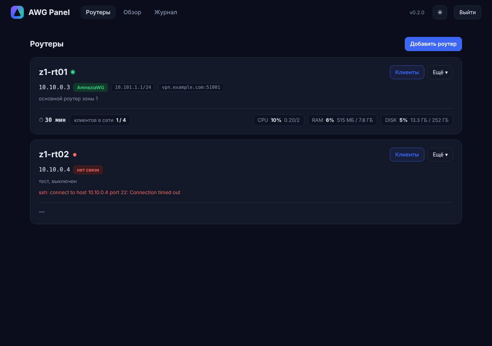
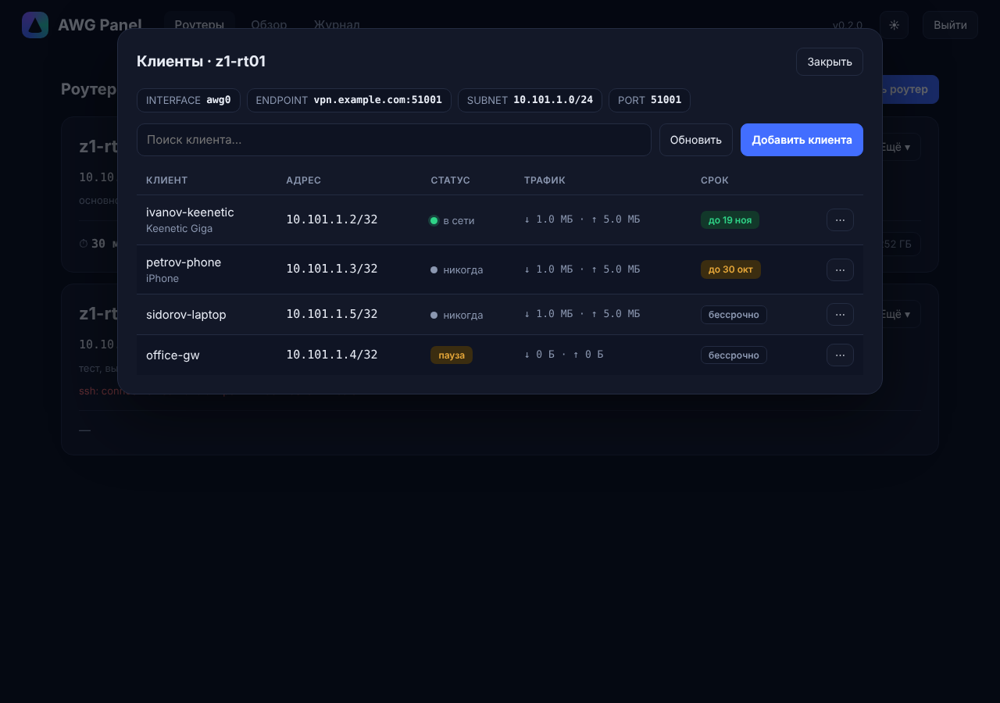
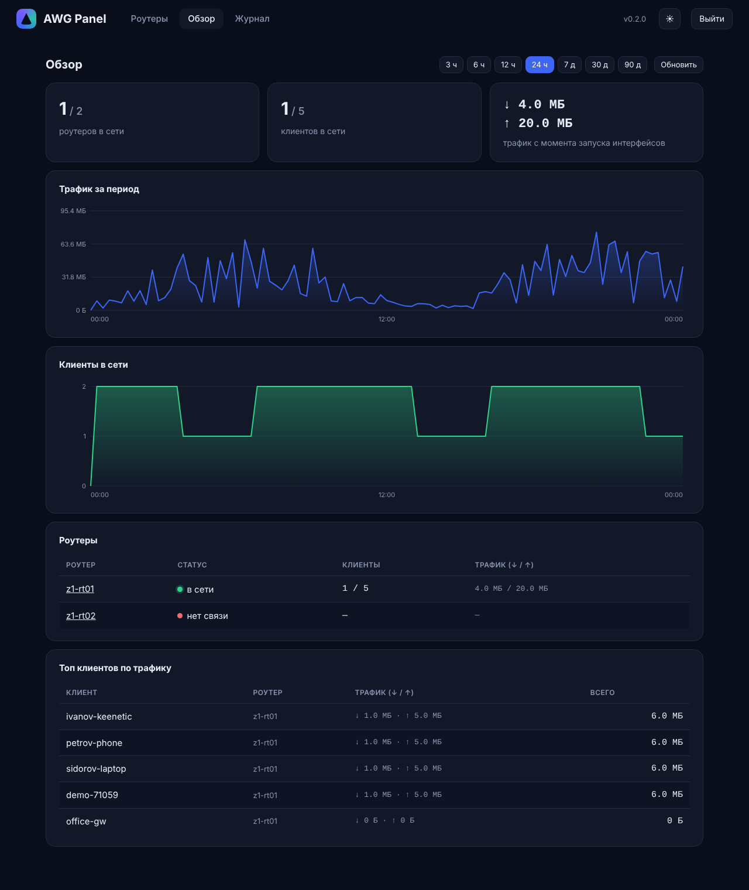

# vodkinnet-awg-panel

Панель выдачи клиентов **AmneziaWG** на виртуальных роутерах OpenWrt (зона за шлюзом OPNsense в Proxmox).
Работает на административной машине зоны (`z1-mgmt`), по SSH-ключу ходит на роутеры и управляет клиентами (пирами) интерфейса `awg0`.

Схема не привязана к модели клиентского роутера: нужен любой роутер или устройство с поддержкой AmneziaWG/WireGuard.



| | |
|---|---|
|  |  |

## Возможности
- несколько роутеров, у каждого свой список клиентов;
- выдача клиента: чистый конфиг (с параметрами обфускации, если они включены на роутере), QR, скачивание `.conf`; конфиг показывается один раз, приватный ключ клиента нигде не хранится;
- режим «ключ создаёт клиент» — для любого клиентского устройства или роутера любой модели, где есть AmneziaWG: вводится только его публичный ключ, приватный никогда не попадает в панель;
- пауза / включение / удаление клиента;
- статус: в сети (handshake < 3 мин), последний handshake, трафик;
- срок действия клиента (автоудаление), продление;
- карточки роутеров: статус, аптайм, CPU / RAM / диск, клиентов в сети;
- обзор: графики трафика и числа клиентов в сети (3 ч … 90 д), топ клиентов;
- журнал действий; вход по паролю; тёмная/светлая тема; слушает только `127.0.0.1`.
- клиенты, созданные в LuCI, тоже видны (пометка «создан не в панели»).

## Состав
- `panel/` — панель: `app.py` (Python 3, Flask, SQLite, JSON API), `templates/`, `static/` (интерфейс на чистом JS, без CDN).
- `router/awg-newpeer` — скрипт на роутере (`add`, `list`, `del`, `pause`, `resume`, `dump`, `status`); панель ставит его на роутер кнопкой «Установить скрипт».
- `install.sh` — установщик на Debian/Ubuntu (пакеты, пользователь `awgpanel`, SSH-ключ, systemd-служба).

## Установка на z1-mgmt
```bash
sudo apt install -y git
git clone --depth 1 https://github.com/beverlypillzz-collab/vodkinnet-rt.git
cd vodkinnet-rt/vodkinnet-awg-panel
sudo ./install.sh 'ПАРОЛЬ_ПАНЕЛИ'
```
В конце выводится публичный SSH-ключ панели. Добавь его на роутер: LuCI → System → Administration → SSH-Keys (для новых роутеров — в шаблон `tpl-openwrt`).

Панель: <http://127.0.0.1:8080> (открывать в браузере на z1-mgmt). Добавь роутер (имя, IP в зоне, внешний `адрес:порт`), нажми «Установить скрипт» и «Проверить связь».

## Обновление
```bash
cd vodkinnet-rt && git pull && cd vodkinnet-awg-panel && sudo ./install.sh --update
```
Пароль, база и ключи сохраняются.

## Требования к роутеру
OpenWrt с пакетами `kmod-amneziawg`, `amneziawg-tools`, `luci-proto-amneziawg`; интерфейс `awg0` с адресом (`10.101.N.1/24`) и `listen_port`; SSH с z1-mgmt разрешён (правило `Allow-MGMT-Admin`).

## Безопасность
- панель доступна только локально (127.0.0.1) и защищена паролем; службa запущена от отдельного пользователя без оболочки;
- в базе нет приватных ключей клиентов; в репозитории нет паролей и ключей;
- SSH-ключ панели даёт root на роутерах зоны — храни `/var/lib/awg-panel` закрытым (права 700).

## Статус
v1: проверена на заглушках (ssh/uci/awg); обкатка на настоящем роутере — впереди.
